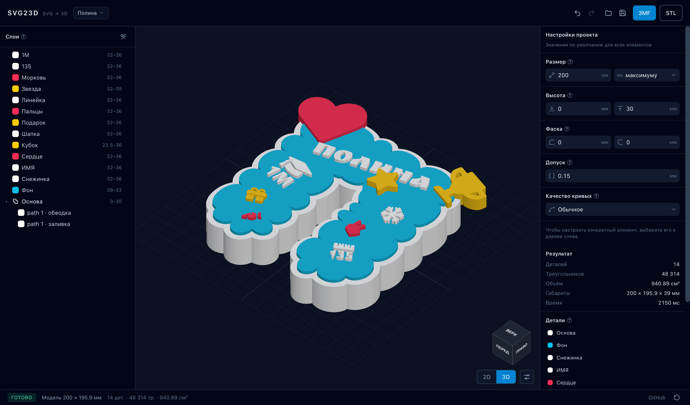

# svg23d



A web app: load a flat SVG (a landscape, a logo, an illustration from a vector editor) and get a
print-ready 3D model — a set of separate parts with sockets, clearances and chamfers.

**Demo:** <https://sergeiterehov.github.io/svg23d/> — built and deployed from `main` automatically
(GitHub Actions → Pages, see `docs/adr/0034-github-pages-deploy.md`).

Documentation (in Russian):

- `docs/PLAN.md` — milestones, acceptance criteria and the current status.
- `docs/adr/` — Architecture Decision Records (why things are the way they are).

## Status

Done: M0–M6 (import, tree, contours, extrusion in a worker, parts with sockets and clearance, 45°
chamfers, 3MF/STL export) and most of M7 (manual layer order, undo/redo, `.svg23d.json` projects,
browser project library, ru/en interface).
Next: presets, print checks (see `docs/PLAN.md`).

## Quick start

```bash
npm install
npm run dev        # http://localhost:5173
npm test           # vitest
npm run lint
npm run build      # tsc --noEmit && vite build (sub-path /svg23d/ for Pages)
npm run preview    # inspect the built bundle: http://localhost:4173/svg23d/
```

Projects live **in the browser**: the last one opens at startup, and the name in the header is a
button that lists every stored project (newest edit first, with its date). Double-click a name in the
list to rename the project; the bin deletes it after confirmation. The save button still downloads
the project as a `.svg23d.json` file, and “Open” accepts both `.svg` and such a file. If an SVG
arrives with a name that already exists in the history, the app asks whether to open the existing
project or create a new one.

An empty **“Untitled”** project exists from the first launch: you can configure and save it, it just
has no elements yet. The layers panel starts with an upload block (“Drop an SVG here” / “Choose a
file”); as soon as an SVG is imported the project takes the file name and the block gives way to the
layer tree. The **“Examples”** dropdown lives in that block: the HTML5 logo, a layered landscape and
outlined text (`samples/name.svg`).

## Language

The interface speaks **Russian and English**. On the first visit the language is detected from the
browser; the globe button in the status bar switches it — “System” (follow the browser), “Русский”
or “English” — and the choice is remembered in this browser only. The selected option is marked with
a check, and “System” shows the language that is currently in effect. Language belongs to the person,
not to the project: opening another project never changes it (ADR-0037).

## How to use

1. Drop an SVG or pick an example. A tree appears on the left: top to bottom is the cut order (as in
   the SVG), and the project takes the file name.
2. Select an element or a group and set the **height from/to**; group settings are inherited by its
   children. “To” cannot go below “From”, and zero thickness is allowed — such an element is simply
   not printed. ⌘/Ctrl-click adds elements to the selection, Shift-click selects a range of rows,
   ⌘/Ctrl+A selects every printable part. The inspector then shows the shared settings — differing
   values appear as a spread in the placeholder (`12-15`) — and edits them all at once. For a group
   or a union the inspector ends with an **“Elements”** block listing what the container is made of;
   clicking a row selects that element. Any numeric field accepts a delta — `+2` or `-2` changes the
   value by that amount (per element in a multi-selection); the value applies on Enter or blur.
3. Mark elements as **separate printed parts** (by default parts are the children of the root `<g>`).
4. Set the **clearance** (per side) and the **chamfers** on top/bottom (45°).
5. In the header of the layers panel, on the right, is the **“Tools”** button (key and hammer). The
   menu is a list of tools (icon, name, one line about what it does); a tool with settings opens a
   dialog on click, and its button runs the action. There are two tools:
   - **“Reduce the number of colours”** asks how many colours to keep and previews the resulting
     palette; the rebuild is a weighted k-means in OKLab — colours that cover more area weigh more,
     so the deviation from the original picture is minimal. “Restore the file colours” removes
     per-element colour overrides;
   - **“Distribute by layers”** computes each part's height from what is visible below it in the top
     view (a raster of the contours, not of the bounds): the bottom sits on the top of the lowest
     support minus the sink (the part bites into it), the top is the layer height above the highest
     support. What is drawn higher also stands higher (a trunk stays under the crowns). Layers
     covered by a later part do not count as supports: a trunk inside a hill stands on the hill, a
     crown sticking into the sky drops down to the sky, and an element in a letter's counter rests on
     the background rather than on a thin stroke. Parts without supports stand on the project base.
     The dialog exposes every number: layer height (5 mm), sink (1 mm), support threshold (2% of the
     area) and the bottom/top of the unsupported parts.
6. The tree is editable. Right-click a row for the context menu (icon + action, only the shortcut on
   the right): “Group” (`⌘G`) wraps the selection in a new group in place of the least nested, highest
   selected element; “Merge” (`⌘U`) does the same but the group prints as one body — the shapes are
   merged with a 2D boolean before extrusion, so there are no internal walls or sockets between them
   and the pieces' own settings do not apply (the contents stay editable: pieces can be pulled out,
   deleted or excluded from the body with “Ignore”); “Split” lifts the pieces to the union's place and
   removes the group itself — exactly like “Ungroup” for a plain group, which lifts the contents to
   the group's place; “Rename”, “Duplicate” (`⌘D`) — the copy is placed above the original and
   selected; “Delete” (`Delete`). A new group arrives collapsed, and the collapsed state of rows is
   stored in the project. Dragging moves an element (or the whole selection) into any group and
   changes the order: the top third of a row means “above it”, the bottom third “below it”, the
   middle of a group “inside it”. Every edit is undoable with `⌘Z`.
   A shape whose fill and stroke share one colour arrives as a union straight away: the stroke is a
   piece of it rather than a separate part with a socket in the fill.
   If an element ends up fully covered by upper ones, a warning appears in the status bar (the ↻
   button there rebuilds the model).
7. The 2D preview paints elements in height order (except the “as is” mode), so the picture matches
   the 3D: whatever was built higher covers what is below. The “height map” mode colours by depth —
   from dark blue to light blue. Hovering an element outlines it in white — in the tree, in 2D and in
   3D alike (selection is always sky-blue so the states never mix, and the white outline is not drawn
   over a selected element); hidden elements are dimmed in the tree, ignored ones are also struck
   through.
   Settings have two different switches: **“Hide”** is view-only (the element is not drawn in 3D and
   is skipped on export, but stays in the model: sockets and volume do not change) and
   **“Ignore”** excludes it from the model, which is equivalent to deleting it (the element stays in
   the tree and in the settings but is not part of 2D or 3D). For a piece of a union the eye in the
   tree and “Ignore the piece” in the settings do the same thing: the piece is merged into the body,
   so it cannot be hidden separately — only taken out of the body (ADR-0035).
   Clicking a part in 3D selects it (sky-blue outline) and opens its settings; clicking empty space
   clears the selection and shows the project settings. Two blue arrows appear on the selected
   element: drag the top one to change “To”, the bottom one to change “From” (0.5 mm steps); the
   inspector values and the geometry update live.
8. Download **3MF** (multi-object + colours) or **STL**.
9. The project saves itself in the browser (the name in the header opens the project list), and the
   floppy button downloads it as `*.svg23d.json`; the folder button opens such a file again.
10. The **2D/3D** switch and the **“View settings”** button (with sliders) sit at the bottom right,
    under the navigation cube. The popover shows only what belongs to the current mode: in 3D —
    projection (perspective/orthographic, icon tabs), lighting (studio/top/flat) and material
    (matte/glossy); in 2D — the 2D mode (transparent/height map/as is). Icon tab names appear as
    tooltips on hover. Display only: geometry is unaffected.
11. The **navigation cube** in the bottom-right corner of the 3D view: click a face (FRONT / BACK /
    LEFT / RIGHT / TOP / BOTTOM) to animate to that view; dragging the cube rotates the model.

Keyboard shortcuts: `⌘Z` / `Ctrl+Z` — undo, `⇧⌘Z` / `Ctrl+Shift+Z` (and `Ctrl+Y`) — redo,
`⌘S` / `Ctrl+S` — save the project, `⌘O` / `Ctrl+O` — open an SVG or a project, `⌘A` / `Ctrl+A` —
select all parts, `⌘G` / `Ctrl+G` — group the selection, `⌘D` / `Ctrl+D` — duplicate,
`Delete` / `⌫` — delete the selection. Inside input fields the combinations work as usual (except
save and open).

Parts are exported in their original coordinates: enable auto-arrange in the slicer so the objects
sit on the bed.

## Structure

- `src/core/` — a pure core without React: `svg/` (parse, styles, transforms, flatten, shapes,
  stroke, units), `geometry/` (section, extrude, mesh), `solver/` (resolveLeaves, inheritance, order,
  buildModel), `export/` (stl, threemf), `model/` (types, defaults, project).
- `src/i18n/` — the ru/en dictionaries, `t()` with `{placeholders}`, locale detection and the
  subscription used by React, the worker and the nav cube (ADR-0037).
- `src/workers/` — Manifold (WASM) in a Web Worker, job/result protocol.
- `src/app/` — React 19 + zustand: `store/`, `components/{layout,tree,inspector,preview,upload,common}`.
- `src/viewer/` — imperative three.js scene (`createViewer`), navigation cube (`navCube`).
- `tests/` — vitest: contours, styles, parsing, geometry invariants, STL/3MF writers, i18n.
- `docs/PLAN.md`, `docs/adr/` — the plan and the Architecture Decision Records.

## What it does (MVP target)

1. Import an SVG keeping the group tree (`<g>`), colours and paint order.
2. Fill and **stroke**: `stroke-width` becomes a separate piece of geometry, so a stroke can have its
   own height, clearance and colour. Masks (`mask`) are honoured: areas hidden by a mask never reach
   the geometry.
3. Assign a `from`/`to` height range to every element or group.
4. Split the artwork into printed parts; elements of upper layers cut their volumes out of the ones
   below with a per-side clearance in millimetres.
5. Top/bottom chamfers (45°, size in mm) at the element level.
6. 2D and 3D preview, 3MF (multi-object, colours) and binary STL export.
7. Russian and English interface with browser detection and a status-bar switcher.
